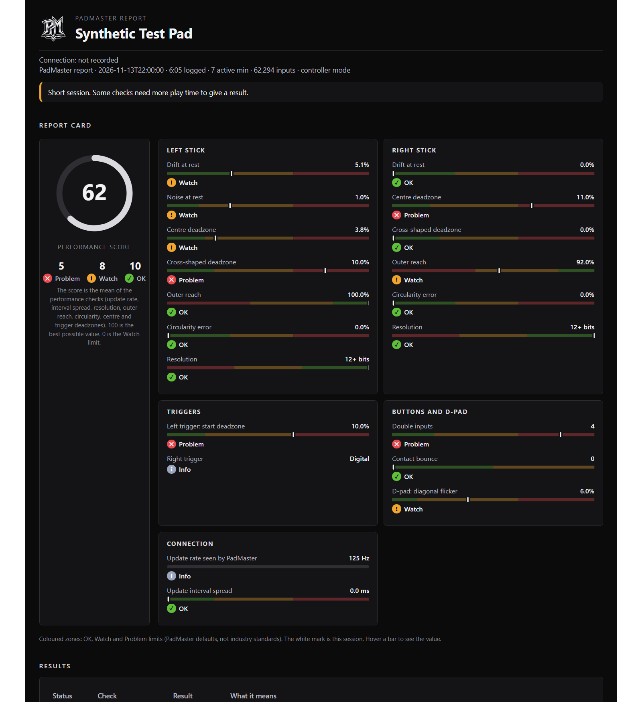
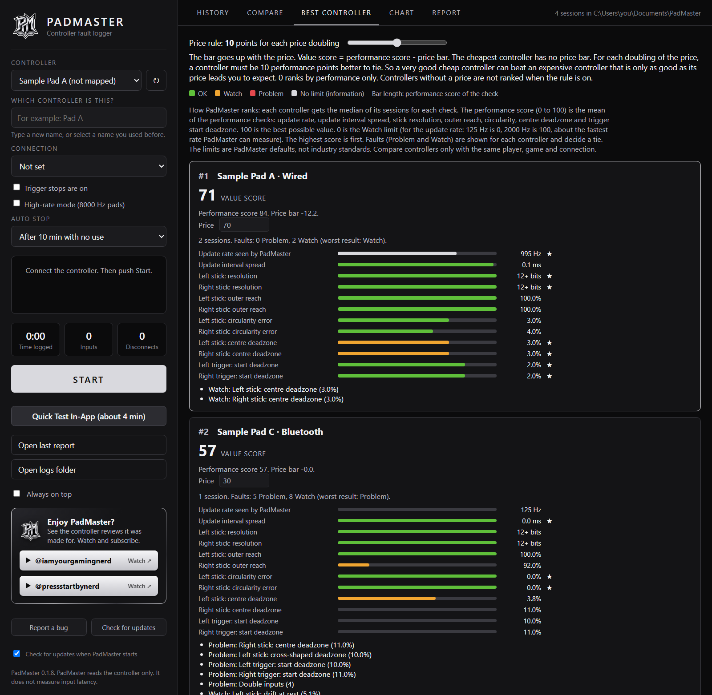
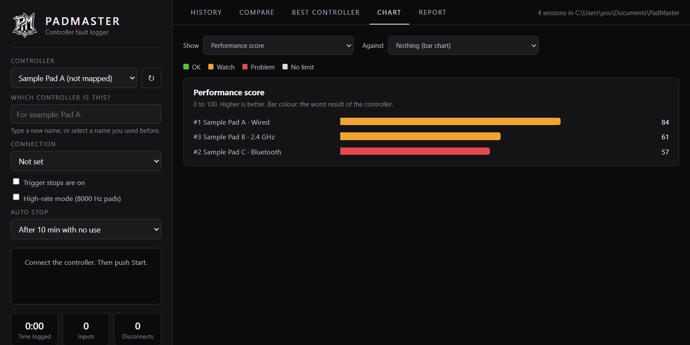
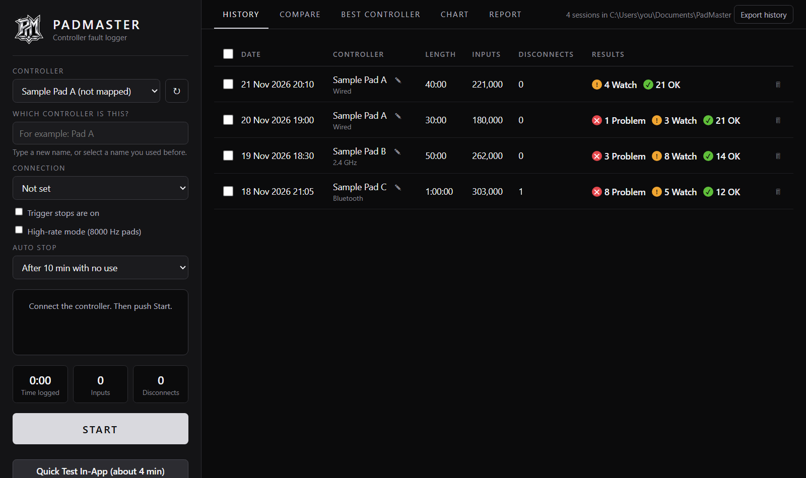

# PadMaster

PadMaster logs your game controller in the background **while you play**. When you stop, it makes a report that shows hidden deadzones, drift, D-pad flicker, double inputs and wireless stutter.

You don't need to do test routines. Play as normal, then read the report.



### Screenshots

All screenshots use sample data, not a real test.

| Best controller | Chart |
|---|---|
|  |  |



> **Status: early version (0.1.8).** Tested on real hardware with the pads in the list below. Other pads can work, but they are not tested. Please report problems in Issues.

### Tested pads

| Pad | Connection | Result |
|---|---|---|
| Xbox One Controller | Wired (USB) | Logging in the background works in fullscreen games. Mapping is correct. All checks give results. |
| DualSense Wireless Controller | Not recorded | Logging works. The D-pad roll check found skipped diagonals that the owner can feel. |

Details: `docs/hardware_results.md`.

## What it checks

| Area | Check | How |
|---|---|---|
| Sticks | Drift at rest | 10-second hands-off check at the start, plus moments in play when you don't touch the stick |
| Sticks | Safe in-game deadzone | Rest offset plus a 2% margin |
| Sticks | In-built centre deadzone | The smallest movement out of centre that the pad ever reports |
| Sticks | Cross-shaped deadzone / snapping | The dead band on one axis while the other axis is pushed |
| Sticks | Outer reach | The maximum value at full tilt in 36 directions |
| Sticks | Stutter while moving | Gaps in the data during continuous movement |
| Sticks | Noise at rest | The spread of the values in the hands-off check |
| Sticks | Circularity error | The average distance of the full-tilt edge from a perfect circle |
| Sticks | Return to centre | The rest position after each push past 50% |
| Sticks | Resolution (info) | The number of different values, the typical step and an estimated bit depth |
| Sticks | Update rate (info) | The time between reports while a stick moves: median, jitter, late reports. This is not latency. |
| Triggers | Start deadzone, full pull, analogue or digital | The smallest and largest values, the number of different values |
| Buttons | Double inputs | A new press less than 20 ms after a release (a hand can't do that) |
| D-pad | Diagonal flicker | A held diagonal drops to one direction for less than 35 ms |
| D-pad | Accidental diagonal blips | A diagonal shows for less than 35 ms during a single-direction press |
| D-pad | Diagonal split time | The time between the first and second direction of a diagonal (info) |
| Buttons | Two-button split time | The time between two buttons pressed together (info) |
| Connection | Disconnects | The controller is lost and comes back |

The report also lists the **time of each event**, so you can find it in your gameplay recording.

## What it can't do

- **True input latency.** That needs hardware that presses the buttons. See [Gamepadla](https://gamepadla.com) for that.
- **Know what you meant to press.** PadMaster only looks for patterns that a hand doesn't make. For hit-rate tests you need a guided test (planned).
- **Precise timing below about 1 ms.** The logger loop runs at about 1 kHz.
- **Gyro and touchpad.** Not logged in this version.

The OK / Watch / Problem limits are PadMaster defaults (judgement calls), not industry standards. You can change them in `THRESHOLDS` in `padlab/analysis.py`.

## Use it (Windows)

### Option A: the .exe

1. Download `PadMaster.exe` from [Releases](../../releases).
2. Connect your controller.
3. Start `PadMaster.exe`. The PadMaster window opens.
   - Windows can show "Windows protected your PC", because the .exe has no paid code signature. Click **More info**, then **Run anyway**. Do not turn off your antivirus. If you are not sure, build PadMaster from the source (Option B).
4. Select your controller. Type which controller this is (for example "Xbox pad A"), or select a name you used before. Select the connection: Wired, Dongle or Bluetooth.
5. Click **START**. Put the controller down for 10 seconds. The window counts down.
6. Play your game. PadMaster keeps logging in the background. The "Inputs" number goes up while you play.
7. Go back to the PadMaster window and click **STOP**. The report opens in the window.
   - **Auto stop:** if you forget, PadMaster stops by itself when you don't use the controller for 10 minutes. Change the time, or set it to Off, in the sidebar. Small stick drift does not count as use.
8. **History** lists every session. Click the pencil to rename a controller. **Compare** shows charts of every check for each controller.

Logs and reports go to `Documents\PadLab`. Use **Open logs folder** to see them.

To delete sessions, tick them in **History** and click **Delete selected**, or click the bin on one row. PadMaster moves the files to `Documents\PadLab\Deleted`. To restore a session, move its files back.

**Report a bug** opens a draft with your PadMaster version, Windows version and controller name. Read it, add what happened, then send it. Attach the log file if you can.

**Updates:** PadMaster asks GitHub for the latest version number once a day when it starts. It sends no data about you. To stop this, clear **Check for updates when PadMaster starts**. **Check for updates** does the same check at any time. When a new version is available, click **Update now**. PadMaster downloads the new PadMaster.exe from the GitHub release and checks it against the checksum that GitHub publishes. Then PadMaster closes, replaces its own file (same folder, same name) and opens again. It downloads nothing until you click. Your logs, controller names and settings do not change. Tip: keep PadMaster.exe in its own folder, not in Downloads.

### Option B: Python

```
pip install -r requirements.txt
python -m padlab gui              # open the window
python -m padlab                  # log in the console, then report
python -m padlab list             # list controllers
python -m padlab log --pad 1      # log the second controller
python -m padlab log --name "Xbox pad A" --connection Dongle   # name and connection in the report
python -m padlab report FILE.csv.gz
```

## Guided test

Push **Quick Test In-App (about 4 min)** to start the guided test. It gives every controller the same steps. Follow the instructions on the screen:

1. Put the controller down (30 s). This checks drift.
2. Turn both sticks in slow circles, then fast circles, then push to the edge in all directions.
3. Pull both triggers slowly, 3 times.
4. Press the arrows and buttons that you see (about 2 minutes).

The report then has a "Guided test" section. The prompt results include your own accuracy, so compare controllers with the same player.

## For a clean test

- Turn off Steam Input, DS4Windows, DSX and similar tools. They change what PadMaster sees.
- Use the same game, player and connection when you compare two controllers.
- Play for at least 10 minutes. Some checks need more data.
- To test wireless stutter, do one session per setup: dongle at the back of the PC, dongle on a USB extension, Bluetooth, wired.

## Test: does Steam Input change what the PC gets?

This test shows if Steam Input changes how often the PC gets new values from the pad. It does not measure input latency.

1. Close Steam fully (right-click the Steam icon in the taskbar, then **Exit Steam**).
2. In PadMaster, name the pad (for example "Xbox pad A, Steam off"). Push **START**. Turn the sticks in full circles for 2 minutes. Push **STOP**.
3. Start Steam. Turn on Steam Input for your pad (Steam > Settings > Controller).
4. Do step 2 again with the name "Xbox pad A, Steam on".
5. Open **Compare**. Look at **Update rate** and **Update spread** for the two sessions.

Use the same pad, the same connection and the same USB port for both sessions. If the update rate shows "at the limit", the real rate can be higher than PadMaster can see. PadMaster checks for input about 1900 times per second on a typical PC, so it can measure rates up to about 1900 Hz. A pad that reports at 4000 or 8000 Hz shows "at the limit". For these pads, select **High-rate mode** before you click Start. PadMaster then checks for input without a pause, so it can measure up to about 8000 Hz, but it keeps one CPU core busy while it logs. Games can run slower on some PCs. The update rate score is 100 at 2000 Hz and above. When Steam Input is on, PadMaster can see Steam's virtual controller and not the real pad (inference, not tested yet). The result then shows what Steam passes on to games.

**Trigger stops:** if your controller has trigger stops (short-travel switches) and they are on, select **Trigger stops are on** before you click Start. Trigger stops change how the triggers report, so PadMaster then does not grade the triggers and does not use them in Compare or Best controller. To test the triggers, turn the stops off and log a new session.

## How it works

- PadMaster uses SDL2 through [pygame-ce](https://github.com/pygame-community/pygame-ce). It sets `SDL_JOYSTICK_ALLOW_BACKGROUND_EVENTS=1`, so it gets controller input while the game has focus.
- It uses the SDL GameController mapping, so all mapped pads use the same names (A, B, LB, D-pad up, and so on). For unmapped pads it guesses the stick axes and does not test triggers.
- It only **reads** the controller. It doesn't send input and doesn't touch the game process. The anti-cheat risk is low, but test it in an offline game first.
- The log is a gzip CSV file with raw values (`t_ms,kind,name,value`). See `padlab/logfile.py`.

## Develop

```
pip install -r requirements.txt pytest
python -m pytest
python tools/make_sample.py       # makes docs/sample_report.html from synthetic data
```

To make a release: push a tag such as `v0.1.0`. GitHub Actions builds `PadMaster.exe` and attaches it to the release.

## Made by

PadMaster is made by the owner of these channels:

- [@iamyourgamingnerd](https://www.youtube.com/@iamyourgamingnerd)
- [@pressstartbynerd](https://www.youtube.com/@pressstartbynerd)

## Licence

MIT. See `LICENSE`.

The controller mappings in `padlab/gamecontrollerdb.txt` come from [SDL_GameControllerDB](https://github.com/mdqinc/SDL_GameControllerDB) (zlib licence, notice kept in the file).
